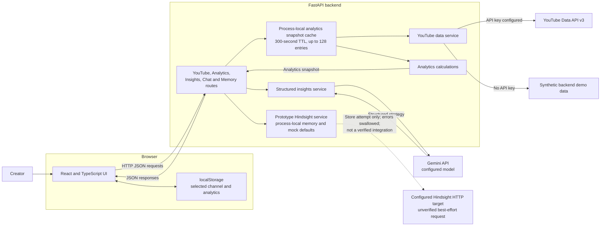

# CreatorIQ

CreatorIQ helps YouTube creators make sense of recent channel performance. It combines channel and video data with computed sample metrics and, when configured, a structured strategy report generated by Google Gemini. The project is intended for independent creators, small creator teams, and developers exploring creator analytics workflows.

## The problem

Creators often have to move between channel metrics and planning tools to understand recent performance and decide what to test next. CreatorIQ brings a recent-video sample, transparent analytics, and an evidence-linked strategy report into one interface. It labels synthetic demo data separately so it is not confused with retrieved YouTube results.

## Features

- **YouTube channel analytics:** Retrieves channel metadata and up to 15 recent uploads, then calculates available view, like, comment, and engagement metrics.
- **Channel dashboard:** Summarizes recent-video metrics, charts video views, and links to sampled videos.
- **AI strategy report:** Sends a validated analytics snapshot to Gemini and renders a structured report with an assessment, observed patterns, content gaps, hypotheses, recommendations, and five content ideas.
- **Content intelligence view:** Displays video performance comparisons and additional guidance. Some narrative guidance on this page is static prototype content, not generated from the current channel.
- **Memory Center and chat API:** Includes a Memory Center and a keyword-routed chat endpoint using a prototype local-memory service. These are not a verified persistent Hindsight Cloud integration; see [Current limitations](#current-limitations).
- **Demo mode:** Provides synthetic analytics when the backend YouTube API key is not configured, and the frontend also has a local synthetic fallback if its analytics request fails. Demo provenance is represented as `demo`.
- **Channel session state:** Keeps the selected channel URL and analytics response in browser `localStorage` so the current dashboard state survives a page reload.

## Screenshots

There are no genuine application screenshots in the repository yet. See the [screenshot capture checklist](docs/screenshots/README.md) for suggested captures and safe capture guidance. Screenshots should be added only after capturing the running application.

## Technology stack

| Group | Technologies used |
|---|---|
| Frontend | React 18, TypeScript, Vite 6, Tailwind CSS 3, React Router, Axios, Recharts, Lucide |
| Backend | Python, FastAPI, Pydantic 2, Uvicorn, `python-dotenv` |
| External APIs | YouTube Data API v3; Google Gemini API via the `google-genai` SDK; an unverified, best-effort Hindsight HTTP request |
| Tools | npm, TypeScript compiler, Python `unittest`, Git |
| Client/process storage | Browser `localStorage`; process-local Python dictionaries for analytics snapshots and prototype memories |

There is no configured SQL database or durable application datastore.

## System architecture



For analytics and insights requests, the backend reuses a process-local snapshot when possible. The insights route passes that snapshot to Gemini instead of independently fetching YouTube data. A successful response retains its `data_source`. Chat and memory routes use the prototype local-memory service; the optional external HTTP request is not used for recall.

## Application workflow

1. The creator submits a supported YouTube channel URL from the React application.
2. The frontend sends an analytics request through Axios. In local development, Vite proxies `/api` requests to FastAPI.
3. The backend validates the URL and checks its process-local analytics snapshot cache. On a cache miss, the YouTube service either queries YouTube Data API v3 or returns synthetic data when the backend API key is not configured.
4. The analytics service calculates aggregates for the returned recent-video sample. The response includes `data_source` (`youtube_api` or `demo`), which the frontend stores with the selected channel in browser `localStorage`.
5. On explicit user action, the AI Strategist sends a request to `/api/insights/channel`. The backend reuses the analytics snapshot and asks Gemini for the defined structured strategy. It validates the response and supporting video titles before returning it.
6. Memory Center and chat endpoints operate separately using process-local prototype memory and hardcoded defaults. They do not provide remote Hindsight recall.

## Project structure

```text
CreatorIQ/
├── backend/
│   ├── config.py                   # Environment-variable loading
│   ├── main.py                     # FastAPI app, CORS and route registration
│   ├── routes/                     # YouTube, analytics, insights, chat, memory
│   ├── schemas/                    # Pydantic request and response models
│   ├── services/                   # YouTube, analytics, Gemini and memory logic
│   └── .env.example                # Backend environment-variable template
├── frontend/
│   ├── src/
│   │   ├── components/             # Shared header, layout, sidebar and metric card
│   │   ├── context/                # Selected channel state
│   │   ├── pages/                  # Dashboard, intelligence, strategist, memory, settings
│   │   ├── services/api.ts         # Axios client and API methods
│   │   └── types/api.ts            # TypeScript API response types
│   ├── package.json                # Frontend scripts and dependencies
│   ├── package-lock.json           # Reproducible npm dependency lock
│   └── vite.config.ts              # Dev server and backend API proxy
├── tests/                          # Python service and route tests
├── requirements.txt                # Python dependencies
├── docs/screenshots/                # Screenshot capture checklist; no captures yet
└── README.md
```

## Prerequisites

- **Python 3.10 or later.** The backend uses Python 3.10 type syntax; `requirements.txt` does not pin a Python minor version.
- **Node.js 18 or later** and npm, for the Vite 6 frontend.
- **Git**, to clone and manage the repository.
- A **YouTube Data API key** for live YouTube data.
- A **Gemini API key** to generate strategy reports.

The backend can start without the YouTube and Gemini keys, but those services then use demo behavior or return a configuration error as described below.

## Installation and setup

You need Python 3.10 or later, Node.js 18 or later, and npm. The Python dependencies are listed in `requirements.txt`; the frontend lockfile is `frontend/package-lock.json`.

### Windows PowerShell

Run the backend setup from the repository root:

```powershell
Set-Location C:\path\to\CreatorIQ
py -m venv .venv
.\.venv\Scripts\Activate.ps1
python -m pip install --upgrade pip
python -m pip install -r requirements.txt
if (-not (Test-Path backend\.env)) {
    Copy-Item backend\.env.example backend\.env
}
notepad backend\.env
```

In a second terminal:

```powershell
Set-Location C:\path\to\CreatorIQ\frontend
npm ci
```

If PowerShell blocks activation scripts, run backend commands through `.\.venv\Scripts\python.exe` instead of activating the environment.

### macOS, Linux, and other POSIX shells

From the repository root:

```bash
python3 -m venv .venv
source .venv/bin/activate
python -m pip install --upgrade pip
python -m pip install -r requirements.txt
if [ ! -f backend/.env ]; then cp backend/.env.example backend/.env; fi
```

Edit `backend/.env` locally and add credentials only for services you intend to use. In a separate terminal, install the locked frontend dependencies:

```bash
cd frontend
npm ci
```

`backend/.env` is ignored by Git. Do not commit credentials.

## Environment variables

The backend template is [`backend/.env.example`](backend/.env.example). `backend/config.py` loads `backend/.env`. No real credentials are documented here.

| Variable | Required? | Purpose and behavior |
|---|---|---|
| `YOUTUBE_API_KEY` | Optional for demo; required for live YouTube data | Used by the YouTube Data API v3 service. If missing or left as the template placeholder, the backend returns clearly tagged synthetic demo data. |
| `GEMINI_API_KEY` | Optional to start; required for AI strategy generation | Authenticates Gemini requests. If absent, the insights service returns a configuration error rather than a generated strategy. |
| `GEMINI_MODEL` | Optional | Selects the Gemini model. The backend configuration defaults to `gemini-3.5-flash-lite` when this variable is unset. |
| `HINDSIGHT_API_KEY` | Optional; not present in `backend/.env.example` | The prototype service combines it with the `Bearer` scheme for HTTP authentication on its best-effort memory POST. The remote integration is not verified or functional as implemented; see [Current limitations](#current-limitations). |
| `HINDSIGHT_BASE_URL` | Optional; not present in `backend/.env.example` | Base URL used for the prototype's external memory POST. The code default is `https://hindsight.vectorize.io`; the configured base URL and request endpoint have not been verified against a working Hindsight API. |
| `VITE_API_BASE_URL` | Optional; not present in the backend template | Read by the frontend Axios client. When empty, the Vite development server proxies `/api` requests to `http://localhost:8000`. Set it in the frontend's Vite environment when using a different backend host. |

The checked-in backend template currently contains only `YOUTUBE_API_KEY`, `GEMINI_API_KEY`, and `GEMINI_MODEL`. `HINDSIGHT_API_KEY` and `HINDSIGHT_BASE_URL` are read by backend configuration but are not listed in that template. `VITE_API_BASE_URL` is a frontend Vite setting and is also not listed in the backend template.

The backend template contains placeholders only. A local `backend/.env` can use placeholder values like these; replace them only with credentials from the respective providers:

```dotenv
YOUTUBE_API_KEY=your_youtube_api_key_here
GEMINI_API_KEY=your_gemini_api_key_here
GEMINI_MODEL=your_gemini_model_name
HINDSIGHT_API_KEY=your_hindsight_api_key_here
HINDSIGHT_BASE_URL=your_hindsight_base_url
```

`GEMINI_MODEL` defaults in backend configuration when unset. Hindsight settings are optional and do not make the prototype integration functional. `VITE_API_BASE_URL` is configured in the frontend's Vite environment, not this backend file. Never put real credentials in source files or documentation.

## Running the application

### Backend

From the repository root, with the virtual environment active (PowerShell or POSIX shell):

```powershell
python -m uvicorn backend.main:app --reload --host 127.0.0.1 --port 8000
```

```bash
python -m uvicorn backend.main:app --reload --host 127.0.0.1 --port 8000
```

- API base URL: <http://localhost:8000>
- Interactive Swagger documentation: <http://localhost:8000/docs>
- Health check: <http://localhost:8000/health>

### Frontend

In a second PowerShell terminal:

```powershell
Set-Location C:\path\to\CreatorIQ\frontend
npm run dev
```

Or in a POSIX shell:

```bash
cd frontend
npm run dev
```

Vite serves the application at <http://localhost:5173> and proxies `/api` requests to the local backend. The backend CORS configuration also allows `http://localhost:3000`.

## API overview

All application endpoints are registered by `backend/main.py`. JSON request and response contracts are defined in `backend/schemas/`.

| Method | Endpoint | Purpose |
|---|---|---|
| `GET` | `/health` | Returns a basic backend health response. |
| `POST` | `/api/youtube/channel` | Retrieves channel metadata and recent videos. |
| `POST` | `/api/analytics/channel` | Returns calculated recent-video analytics and `data_source`. Uses the shared snapshot cache. |
| `POST` | `/api/insights/channel` | Reuses the analytics snapshot and requests a structured Gemini strategy report. Requires Gemini configuration to generate a report. |
| `POST` | `/api/chat` | Prototype keyword-routed strategist reply and memory interaction; this is not the Gemini strategy endpoint. |
| `GET` | `/api/memory/{channel_id}` | Returns memory clusters from the prototype memory service. |
| `POST` | `/api/memory` | Adds a memory item to the process-local service and attempts optional external synchronization. |

The YouTube, analytics, and insights endpoints accept a JSON body shaped as `{"channel_url": "https://www.youtube.com/@handle"}`. The chat endpoint accepts `channel_id`, `message`, and optional `channel_context`; the memory write endpoint accepts `channel_id`, `title`, `content`, and `category`. Use `/docs` for the generated OpenAPI schema and validation details.

## Testing and build checks

Run the backend tests from the repository root:

```powershell
python -m unittest discover -s tests
```

The frontend TypeScript check and production build are combined in the configured script:

```powershell
Set-Location frontend
npm run build
```

The backend test command was run while preparing this README and passed with **44 tests**. The frontend package does not define a lint script.

## Current limitations

- **Demo data is not YouTube data.** The backend returns synthetic records when its YouTube API key is missing or is the template placeholder. Separately, the frontend analytics client catches analytics request failures and creates local synthetic demo analytics. The responses are tagged `demo`; do not treat these metrics as real channel results.
- **Live API failures are not equivalent to demo success.** When a non-placeholder YouTube key is configured, backend YouTube API errors are returned as errors. The frontend's separate analytics fallback can still display local demo data if its analytics request fails.
- **Analytics describe a recent sample.** The backend retrieves up to 15 recent videos. Derived averages and engagement rates represent available data in that sample, not the channel's lifetime performance, audience retention, or audience demographics.
- **Gemini output is generated, not guaranteed.** Strategy generation requires a working Gemini configuration and provider response. The backend validates structured output, recommendation/idea counts, and evidence references; unsupported video references are removed rather than matched approximately.
- **The analytics snapshot cache is process-local.** It has a five-minute TTL and a 128-entry capacity. It is not durable, shared between workers, or a database.
- **Memory is a prototype, not durable vector memory.** The service stores items in a Python in-memory dictionary, provides hardcoded default memories when no items exist, and the chat route creates keyword-based replies. Process restarts clear locally stored memories.
- **Hindsight Cloud integration is not functional as implemented.** The service intends to use `HINDSIGHT_API_KEY` for HTTP Bearer authentication, then attempts a POST using the configured base URL plus `/api/v1/memories` and a `channel_id`/`title`/`content`/`category` payload. The base URL, endpoint, and payload have not been verified against a working Hindsight API contract; the request also lacks a bank ID. Memory recall reads only the local in-process dictionary and never calls a remote recall endpoint. External request errors are swallowed, so failed sync is not reported to callers. Configuring the Hindsight variables alone does not enable working Cloud storage or retrieval.
- **Some dashboard guidance is static.** The dashboard and Content Intelligence page include narrative claims and example guidance that are not calculated from the selected channel's data or produced by Gemini. The AI Strategist report is the separate backend-generated report.
- **No authentication or user/account persistence is implemented.** The app is designed as a local prototype; do not expose it publicly with private API credentials without adding appropriate access controls.
- **No deployment or automation configuration is included.** The inspected repository does not contain a Dockerfile, deployment manifest, or CI workflow.

## Future improvements

- Complete and test Hindsight integration against the provider's documented API and authentication requirements, or remove unsupported integration claims from the UI.
- Replace prototype chat behavior and canned memory defaults with explicit, validated AI and memory workflows.
- Make analytics failures visibly distinct from local demo fallback throughout the UI.
- Replace static dashboard guidance with clearly sourced metrics or generated recommendations.
- Add durable, shared storage and a distributed cache if multi-process deployment is required.
- Add authentication, rate limiting, structured operational logging, and deployment-specific CORS configuration before public hosting.
- Add frontend interaction tests and automated linting to complement the existing backend tests and production build.
- Add and maintain genuine screenshots for the application states listed in [`docs/screenshots/README.md`](docs/screenshots/README.md).

## Contributing

Contributions should preserve the explicit distinction between YouTube API data and demo data. For behavior changes, update the relevant backend tests or frontend types and run the test/build commands above. Keep credentials in local environment files and never include them in commits.

## License

No license has been specified in this repository. All rights remain with their respective owners; contact the project maintainers before reusing or distributing the code.
